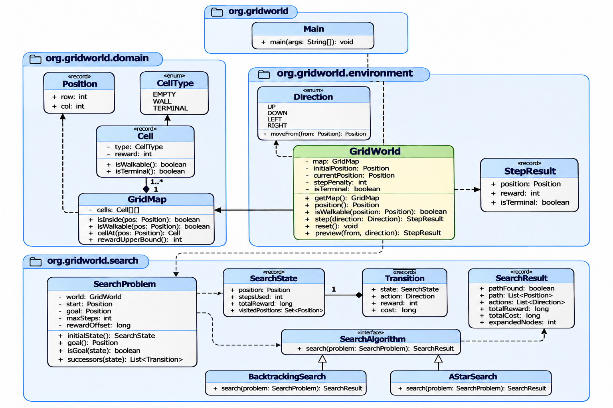

# GridWorld RL Agent

A Java project for building an intelligent agent that navigates a grid, avoids obstacles, and makes reward-aware decisions.

**Status:** In development — building and testing the environment before implementing the agent algorithm.

**Tech stack:** Java 21 · Gradle · JUnit Jupiter

## Architecture

The grid environment is independent of the decision-making algorithm, keeping the code simple, testable, and extensible.



_Planned class structure; not all classes are implemented yet._

## Project structure

```text
GridWorld-RL-Agent/
├── app/
│   ├── build.gradle.kts
│   └── src/
│       ├── main/java/org/gridworld/
│       │   ├── Main.java
│       │   ├── domain/          # Position, CellType, Cell, GridMap
│       │   ├── environment/     # GridWorld, StepResult, Direction
│       │   └── search/          # Search algorithms and shared models
│       │
│       └── test/java/org/gridworld/
│           ├── MainTest.java
│           ├── domain/          # Domain unit tests
│           ├── environment/     # Environment unit tests
│           └── search/          # Search algorithm unit tests (planned)
├── docs/                        # Architecture notes and UML diagrams
├── settings.gradle.kts
└── gradlew / gradlew.bat
```

_The search package and its tests are planned for v0.2.0._

_Some files in this structure are planned for upcoming milestones._

## Build and test

From the repository root:

```bash
# macOS / Linux
./gradlew :app:run
./gradlew :app:test
```

Windows PowerShell:

```powershell
.\gradlew.bat :app:run
.\gradlew.bat :app:test
```

## Next milestone

**Status:** v0.1.0 completed - developing v0.2.0 with Backtracking and A\* search.

### v0.2.0 — Intelligent Agent

- Introduce a non-mutating transition mechanism.
- Define shared search models and contracts.
- Implement Backtracking and A\* search.
- Support bounded reward maximization.
- Test algorithm correctness and compare performance.
