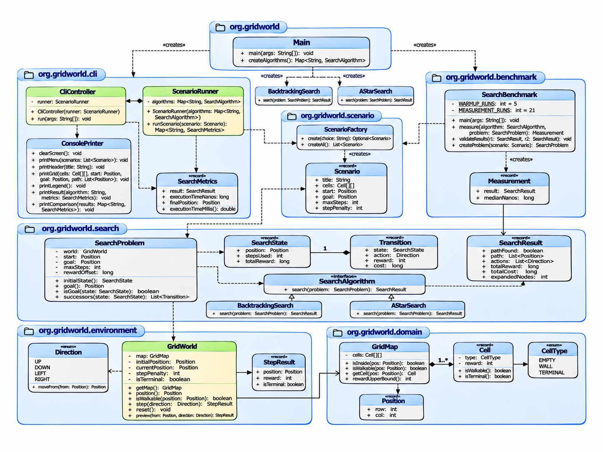

# GridWorld RL Agent

A Java implementation of a GridWorld agent using Backtracking and A* search to navigate a grid and maximize rewards within a step limit.

**Status:** v0.2.0 released — v0.3.0 in development.

**Tech stack:** Java 21 · Gradle · JUnit 5 · GitHub Actions

## Architecture

The environment and search algorithms are implemented independently.



_Planned architecture for v0.3.0._

## Project structure

```text
GridWorld-RL-Agent/
├── app/
│   ├── build.gradle.kts
│   └── src/
│       ├── main/java/org/gridworld/
│       │   ├── Main.java
│       │   ├── domain/
│       │   ├── environment/
│       │   ├── search/
│       │   ├── cli/
│       │   ├── scenario/
│       │   └── benchmark/
│       └── test/java/org/gridworld/
├── docs/
├── settings.gradle.kts
└── gradlew / gradlew.bat
```

## Build and test

### Linux / macOS

```bash
# Start the interactive menu
./gradlew --console=plain -q :app:run

# Run tests
./gradlew :app:test
```

### Windows

```powershell
# Start the interactive menu
.\gradlew.bat --console=plain -q :app:run

# Run tests
.\gradlew.bat :app:test
```

## Roadmap

### v0.1.0 — GridWorld Foundation

- Grid, cells and environment.
- Movement and reward rules.
- Unit tests.

### v0.2.0 — Intelligent Agent

- Backtracking and A* search.
- Bounded reward maximization.
- Interactive CLI with four scenarios.
- Execution time and expanded nodes.
- 153 passing tests.

### v0.3.0 — Evaluation & Optimization (in progress)

- CLI and scenario refactoring.
- Additional scenarios.
- Search benchmarking with warm-up runs and median execution times.
- Performance comparison and additional tests.