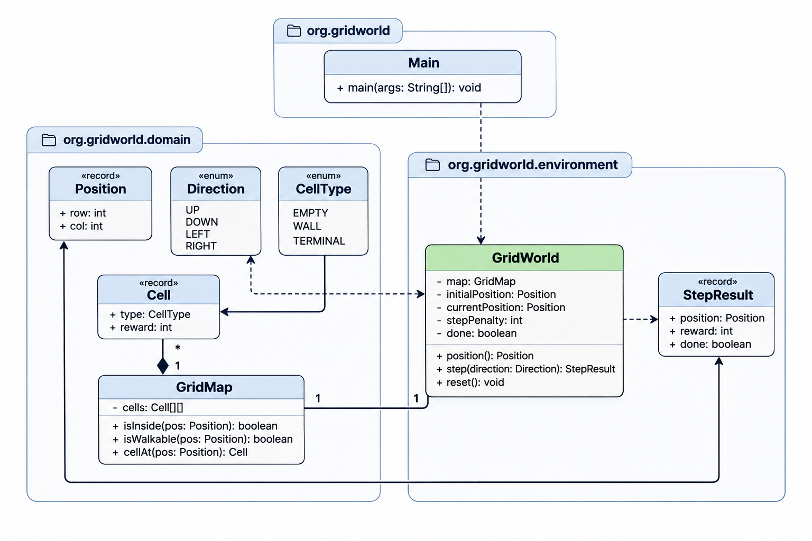

# GridWorld RL Agent

A Java project for building an intelligent agent that navigates a grid, avoids obstacles, and makes reward-aware decisions.

**Status:** In development — building and testing the environment before implementing the agent algorithm.

**Tech stack:** Java 21 · Gradle · JUnit Jupiter

## Architecture

The grid environment is independent of the decision-making algorithm, keeping the code simple, testable, and extensible.



*Planned class structure; not all classes are implemented yet.*

## Project structure

```text
GridWorld-RL-Agent/
├── app/
│   ├── build.gradle.kts
│   └── src/
│       ├── main/java/org/gridworld/
│       │   ├── Main.java
│       │   ├── domain/          # Position, Direction, CellType, Cell, GridMap
│       │   └── environment/     # GridWorld, StepResult
│       └── test/java/org/gridworld/
│           ├── MainTest.java
│           ├── domain/          # Domain unit tests
│           └── environment/     # Environment unit tests
├── docs/                        # Architecture notes
├── settings.gradle.kts
└── gradlew / gradlew.bat
```

*Some files in this structure are planned for upcoming milestones.*

## Build and test

From the repository root:

```bash
# macOS / Linux
./gradlew :app:run
./gradlew :app:test
```

Windows PowerShell:

```powershell
.\gradlew.bat :app:run
.\gradlew.bat :app:test
```

## Next milestone

Implement and test grid boundaries, obstacles, movement, terminal states, and rewards. Then introduce and evaluate the selected agent algorithm.